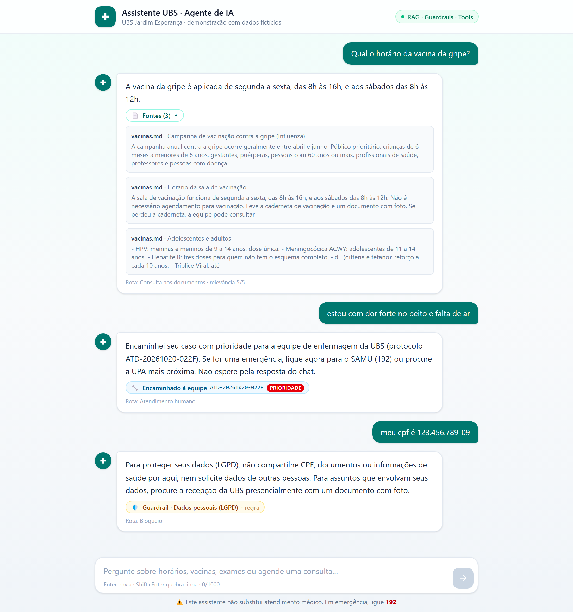
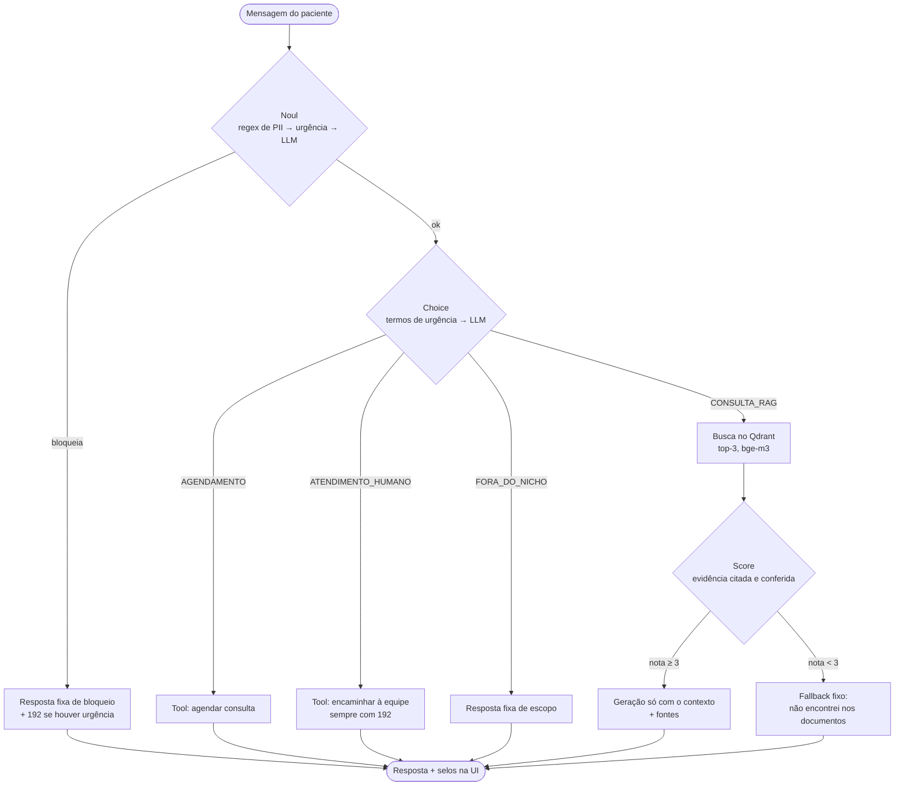

# Assistente UBS · Agente de IA

[](https://github.com/ricardodatadev/agente-ia/actions/workflows/ci.yml)

Assistente virtual para pacientes de uma Unidade Básica de Saúde (UBS) que **responde dúvidas com RAG**, **bloqueia mensagens ofensivas e dados pessoais antes de qualquer busca ou geração (LGPD)** e **agenda consultas ou encaminha para a equipe via tool calling** — tudo rodando **localmente**, com LLM no Ollama, com um único `docker compose up`.

> ⚠️ Projeto de demonstração/portfólio. Os documentos da UBS são **fictícios** e o assistente **não substitui atendimento médico** — em emergência, ligue 192.



**Stack:** Python 3.12 · FastAPI · LangGraph · Pydantic · Qdrant · Ollama (Llama 3.2 3B + bge-m3) · React 19 · TypeScript · Tailwind 4 · Docker Compose

---

## Destaques

- **Grafo LangGraph com 3 decisões tipadas** — *Noul* (segurança), *Choice* (intenção) e *Score* (relevância) — cada uma podendo encerrar o fluxo cedo, sem gastar tokens à toa.
- **Camadas determinísticas antes do LLM:** regex de CPF/CNS/RG/telefone/e-mail e termos de urgência decidem em milissegundos e com zero tokens.
- **Falha segura em tudo:** saída inválida do LLM vira bloqueio `INDETERMINADO`, rota de consulta protegida pelo Score ou nota 1 (fallback) — nunca uma resposta inventada.
- **Score ancorado em evidência:** o LLM precisa citar a frase do documento; o código confere se a citação existe e se trata do assunto perguntado.
- **Tools com permissão mínima:** cada rota vincula **uma** ferramenta ao LLM; os argumentos são validados com Pydantic antes de executar.
- **Spec-Driven Development:** requisitos, critérios de aceite, ADRs e checklists em [`docs/spec-driven/`](docs/spec-driven/SPEC.md); cada decisão revista com dados da avaliação está registrada lá.
- **Avaliação com LLM real** em 50 casos rotulados, **199 testes** automatizados sem Docker, rodando no CI a cada push, e testes de integração contra a stack real.

## Arquitetura



| Componente | Papel |
| :--- | :--- |
| `backend/app/graph.py` | Nós e arestas do LangGraph; latência por nó e contagem de chamadas ao LLM |
| `backend/app/guardrails.py` | Camadas determinísticas (regex de PII, termos de urgência) e orquestração das decisões |
| `backend/app/judge.py` | Decisões do modo local: JSON validado por Pydantic, retries, falha segura, Score ancorado em evidência |
| `backend/app/rag.py` | Chunking por seção Markdown, ingestão idempotente no Qdrant, busca |
| `backend/app/tools.py` | Contratos tipados, normalização de especialidade e mocks com protocolo |
| `backend/app/prompts.py` | Prompts e textos fixos do domínio — o que muda ao trocar de nicho |
| `backend/app/main.py` | API FastAPI, logs JSON, 503 amigável, health check, ingestão e aquecimento no startup |
| `frontend/` | Chat React com selos de guardrail, ação, fontes e "sem evidência" |

## As 3 decisões

| Decisão | Pergunta | Camada determinística (0 tokens) | Camada LLM | Falha segura |
| :--- | :--- | :--- | :--- | :--- |
| **Noul** | A mensagem deve ser bloqueada? | Regex de CPF, CNS, RG, telefone, e-mail | Ofensa e PII semântica ("o resultado do exame da Ana Lima") | Saída inválida 2× → bloqueio `INDETERMINADO` |
| **Choice** | Qual a intenção? | 18 termos de urgência → atendimento humano | 4 intenções com exemplos em PT-BR | Inválida 2× → `CONSULTA_RAG` (o Score protege) |
| **Score** | Os trechos respondem à pergunta? | Citação conferida nos trechos e no assunto | Nota 1–5 + frase citada | Inválida → nota 1 → fallback |

### Economia de tokens: encerramento antecipado

| Tipo de mensagem | Chamadas ao LLM | Tempo típico (CPU) |
| :--- | :---: | :--- |
| CPF, telefone, e-mail (regex) | **0** | ~10 ms |
| Urgência com termo conhecido | **0** | ms (encaminhamento com protocolo e 192) |
| Ofensa / PII semântica | 1 | ~4 s |
| Fora do escopo | 2 | ~7 s |
| Agendamento / atendente | 3 | 9–33 s |
| Pergunta sem resposta nos documentos | 3 | ~30 s (fallback, sem geração) |
| Pergunta respondida pelo RAG | 4 | 60–80 s |

Respostas de bloqueio, fora do escopo, fallback e das tools são **textos fixos** (ADR-03): determinísticas, revisáveis e sem custo de geração.

## Por que guardrails importam aqui

| Risco | Guardrail | Como funciona |
| :--- | :--- | :--- |
| Urgência médica sem orientação | Termos de urgência com precedência sobre o LLM; 192 em toda resposta de atendimento; CVV (188) em menção a suicídio | Determinístico: não depende do modelo acertar |
| Vazamento de dados (LGPD) | Noul em duas camadas; histórico com PII descartado; logs só com metadados | Nenhum texto de mensagem é gravado em log |
| Alucinação | Score com evidência conferida no código; geração restrita ao contexto; fontes exibidas | Sem evidência → resposta fixa, nada é gerado |
| Uso fora do propósito / prompt injection | Choice com rota de escopo; prompts nunca revelam instruções | Resposta fixa |
| Ação indevida por tool | Uma tool por rota; argumentos validados antes de executar | Especialidade ausente ou inexistente → pergunta, não executa |

## Como rodar

**Pré-requisito:** apenas [Docker](https://docs.docker.com/get-docker/) com Compose v2. Recomendado: **8 GB de RAM livres para o Docker**. GPU não é necessária (com ela, tudo fica bem mais rápido).

```bash
git clone https://github.com/ricardodatadev/agente-ia.git
cd agente-ia
docker compose up --build
```

Abra **http://localhost:5173**. A API fica em http://localhost:8000 (`/docs` para o OpenAPI, `/health` para o status).

- **Primeira subida:** baixa a imagem do Ollama (~9 GB) e os modelos (~3 GB), ingere os documentos e aquece os modelos. Leva alguns minutos; nas próximas, tudo vem do cache dos volumes.
- **Configuração opcional:** `cp .env.example .env` para trocar modelo, `TOP_K`, limiares etc. Sem `.env`, valem os padrões.
- **Portas usadas:** 5173, 8000, 6333 e 11434 (pare um Ollama local antes de subir).
- **Modo demonstração:** por padrão, cada resposta mostra a rota do grafo e a nota de relevância (útil para entender o fluxo). Para uma interface com cara de produto (só texto, selos e fontes), use `SHOW_DEBUG=false` no `.env` e reconstrua o frontend: `docker compose up -d --build frontend`.

### Modelos e provedores

O LLM é escolhido só pelo `.env` (`LLM_PROVIDER` + `LLM_MODEL`); o grafo não muda. Embeddings (`bge-m3`) e Qdrant ficam **sempre locais**.

| Opção | `.env` | Observação |
| :--- | :--- | :--- |
| **Llama 3.2 3B** (padrão) | `LLM_PROVIDER=ollama` · `LLM_MODEL=llama3.2:3b` | Roda em CPU com ~8 GB de RAM; único avaliado que atingiu todas as metas |
| Llama 3.1 8B | `LLM_MODEL=llama3.1:8b` | Mais preciso; pede GPU ou mais RAM |
| Qwen 2.5 3B / 1.5B | `LLM_MODEL=qwen2.5:3b` | Avaliado contra o Llama: Choice melhor, mas errou urgência (ADR-12) |
| Claude (API Anthropic) | `LLM_PROVIDER=anthropic` · `ANTHROPIC_API_KEY=...` | Respostas em segundos, sem GPU |
| Gemini (API Google) | `LLM_PROVIDER=google` · `GOOGLE_API_KEY=...` | Respostas em segundos, sem GPU |

> **LGPD:** com `anthropic` ou `google`, as mensagens dos pacientes são enviadas a um serviço externo. Com o padrão (`ollama`), nada sai da máquina.

Os blocos prontos para copiar estão no [`.env.example`](.env.example). Sem chave, o backend se recusa a subir e diz qual variável falta.

### Reingerir documentos

A ingestão roda sozinha no startup quando a coleção está vazia. Depois de editar `backend/data/`:

```bash
docker compose run --rm backend python scripts/ingest.py
```

É idempotente: cada arquivo tem IDs determinísticos e seus chunks antigos são substituídos.

### Problemas comuns

| Sintoma | Causa e solução |
| :--- | :--- |
| Respostas estouram o tempo depois de trocar `LLM_MODEL` | Os modelos ficam sempre em memória (`OLLAMA_KEEP_ALIVE=-1`); o anterior continua ocupando RAM. Rode `docker compose restart ollama`. |
| `/health` com `"qdrant": "erro"` ou `"ollama": "erro"` | Serviço ainda subindo ou sem memória no Docker. Veja `docker compose logs ollama` e aumente a RAM do Docker Desktop. |
| Backend não sobe com `LLM_PROVIDER=anthropic` ou `google` | Falta a chave da API no `.env`; a mensagem de erro cita a variável. |
| Porta 11434 em uso | Já existe um Ollama rodando fora do Docker: pare-o antes do `docker compose up`. |

## Testes e avaliação

```bash
cd backend
pip install -r requirements-dev.txt
pytest                      # 199 testes, sem Docker (LLM, retriever e Qdrant falsos ou em memória)
pytest -m integration       # contra a stack real: Qdrant + bge-m3 + API no ar
python tests/eval/run_eval.py   # avaliação com o LLM real nos 50 casos de tests/eval/dataset.jsonl
```

### Resultados da avaliação

50 casos rotulados (RAG coberto e não coberto, agendamento, urgência, atendimento, fora do escopo, ofensa e PII), `llama3.2:3b` em CPU, decisões no modo local:

| Métrica | Resultado | Meta |
| :--- | :--- | :--- |
| Choice (intenção) | 35/39 (90%) | ≥ 85% ✅ |
| Noul: bloqueios corretos / motivo correto | 11/11 / 11/11 | ✅ |
| RAG coberto respondido | 12/12 (100%) | ✅ |
| Recall de urgência | 7/7 (100%): 6 por regra determinística + 1 sem termo conhecido, identificado pelo LLM | 100% ✅ |
| Tool correta (agendamento e encaminhamento) | 17/17 (100%) | ✅ |
| Respostas fiéis ao contexto (revisão manual) | 8/10, 1 com redação confusa, 1 com frase não suportada | — |
| Resposta RAG completa | ~70 s em CPU | — |

**O que a avaliação mudou no sistema** — a parte mais útil de medir com o LLM real:

- O Noul-LLM bloqueou *"meu filho se envenenou"* como PII e *"estou pensando em me matar"* como ofensa. Um erro desses deixa o paciente sem orientação → **termos de urgência agora passam à frente do LLM** (a regex de PII continua antes).
- O Llama deu nota 4 a *"aceita plano de saúde?"* citando uma frase real, mas de outro assunto, e inventou a resposta → o Score passou a conferir **se o trecho citado trata do assunto da pergunta**. A primeira versão dessa regra ficou estrita demais e rebaixou 2 respostas corretas; a avaliação mostrou e ela foi ajustada.
- A primeira pergunta após `docker compose up` dava **503** (modelo frio) → **aquecimento no startup**: 216 s → 98 s na 1ª pergunta.

Números completos e decisões em [docs/spec-driven/checklists/08-testes-avaliacao.md](docs/spec-driven/checklists/08-testes-avaliacao.md) e nos ADRs da SPEC.

## Decisões de arquitetura (resumo)

Detalhes, alternativas e motivos em [SPEC §9](docs/spec-driven/SPEC.md#9-decisões-arquiteturais-adrs-resumidos).

| ADR | Decisão | Por quê |
| :--- | :--- | :--- |
| 01 | Noul em duas camadas (regex → LLM) | Regex zera tokens nos casos óbvios; LLM cobre o semântico |
| 02 | Backend sem estado; histórico no cliente | Menos superfície LGPD e menos infraestrutura |
| 03 | Respostas fixas para bloqueio, escopo, fallback e tools | Determinismo, zero tokens, texto revisável |
| 04 | Uma tool por rota no `bind_tools` | Permissão mínima; o roteamento já foi decidido pelo Choice |
| 07 | Termos de urgência antes dos LLMs | Falso negativo em urgência é o erro mais caro do sistema |
| 08 | Especialidade em texto livre, normalizada no código | Com enum, modelos pequenos "escolhem" uma especialidade que o paciente não disse |
| 09/10 | Llama 3.2 3B em CPU, timeout 120 s, top-k 3, modelos sempre em memória | Cabe na RAM do Docker e é ~3× mais rápido que o 8B |
| 11 | Score com citação conferida no código | O modelo pequeno dava notas incoerentes com a própria citação |

## Como trocar de nicho

A mecânica (grafo, decisões, guardrails, API, UI) é independente do domínio. Para outro serviço (clínica, prefeitura, suporte):

1. Substitua os documentos em `backend/data/` e reingira.
2. Ajuste os prompts e textos fixos em `backend/app/prompts.py`.
3. Troque as tools e as listas de domínio em `backend/app/tools.py` (especialidades → seus serviços).
4. Revise os termos de urgência em `backend/app/guardrails.py`.
5. Reescreva o dataset de avaliação e rode `run_eval.py` antes de considerar as metas atingidas.

## Limitações conhecidas e próximos passos

- **Latência em CPU:** perguntas respondidas pelo RAG levam ~1 minuto (Score + geração). Com GPU, ou trocando `LLM_MODEL` para um modelo maior/hospedado, cai para segundos.
- **Erros que falham de forma segura:** "qual o nome do diretor?" foi classificada como fora do escopo e um prompt injection foi bloqueado como `INDETERMINADO` — ambos com texto fixo, nada inventado.
- **Geração com modelo pequeno:** na revisão manual, 1 de 10 respostas acrescentou uma frase que não está nos documentos (sem risco clínico). Próximo passo: modelo maior ou verificação da resposta contra o contexto.
- **Busca:** sem re-ranking nem busca híbrida (ADR-05); a avaliação não mostrou necessidade.
- **Escopo:** sem agendamento real, autenticação ou persistência de conversas (por decisão, LGPD).
- **Próximos passos:** streaming das respostas, suporte a PDF na ingestão, métricas no Prometheus.

---

Feito por **Ricardo Pereira**.
