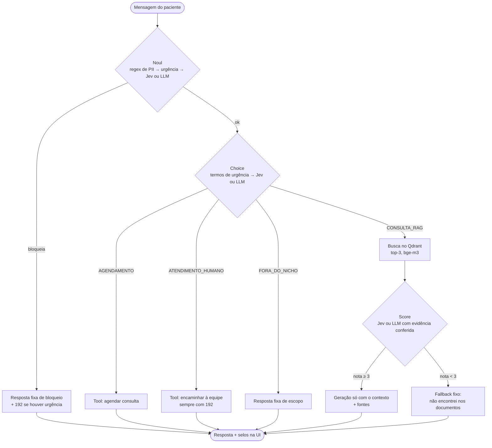

# Saúde Digital · Assistente virtual do SUS municipal

[](https://github.com/ricardodatadev/agente-ia/actions/workflows/ci.yml)

Assistente virtual de atendimento ao cidadão, pensado como **módulo de uma plataforma de saúde digital do SUS municipal** (app ou portal da Secretaria Municipal de Saúde), sobre toda a rede: UBS, farmácia, CAPS e UPA.

- **Responde com RAG e mostra as fontes:** unidades, horários, vacinas e exames, além de informações gerais de saúde do Ministério da Saúde, sem diagnóstico nem remédio.
- **Bloqueia ofensas e dados pessoais (LGPD)** antes de qualquer busca ou geração; urgência recebe o 192 primeiro.
- **Agenda consultas e encaminha para a equipe** via tool calling, com protocolo.

As decisões do fluxo são tomadas pelo **Jev da TypeSafe AI** ou, sem chave, por um **modo local** com o próprio LLM. Tudo roda localmente com `docker compose up --build`.

> ⚠️ Projeto de demonstração/portfólio. O município é genérico e as unidades (UBS Jardim Esperança, Vila Nova e Santa Clara) são **fictícias**, com endereços e telefones fictícios; os de saúde geral (`backend/data/saude-*.md`) são resumos de páginas públicas do Ministério da Saúde, com a fonte no topo de cada arquivo. O assistente **não substitui atendimento médico** — em emergência, ligue 192.


**Stack:** Python 3.12 · FastAPI · LangGraph · Pydantic · Jev (TypeSafe AI) · Qdrant · Ollama (Llama 3.2 3B + bge-m3) · React 19 · TypeScript · Tailwind 4 · Docker Compose

---

## Destaques

- **Grafo LangGraph com 3 decisões tipadas** — *Noul* (segurança), *Choice* (intenção) e *Score* (relevância) — cada uma podendo encerrar o fluxo cedo, sem gastar tokens à toa.
- **Motor de decisões plugável:** o grafo depende de uma interface (`Judge`); o **Jev da TypeSafe AI** responde via SDK oficial, com perguntas versionadas em `backend/jevs/*.json` e validadas na inicialização, e o **modo local** usa o LLM configurado com saída JSON validada.
- **Camadas determinísticas:** regex de CPF/CNS/RG/telefone/e-mail (inclusive com espaços e "arroba") decide em milissegundos e com zero tokens. Para urgência, a regra de termos — com **trava de negação** ("não estou com dor no peito" não é urgência) — é o **plano B**: quem decide é o Jev, e a regra assume se ele estiver fora do ar ou sem chave.
- **Falha segura nas decisões:** saída inválida do LLM vira bloqueio `INDETERMINADO`, rota de consulta protegida pelo Score ou nota 1 (fallback) — uma decisão quebrada nunca libera uma resposta sem evidência.
- **Score ancorado em evidência:** o LLM precisa citar a frase do documento; o código confere se a citação existe e se trata do assunto perguntado.
- **Informação de saúde sem diagnóstico:** perguntas gerais sobre dengue, gripe, hipertensão e diabetes são respondidas com resumos do Ministério da Saúde e terminam com um aviso fixo, escrito no código; quem relata o que sente, pergunta "será que é dengue?" ou pede um remédio é encaminhado à equipe.
- **Tools com permissão mínima:** cada rota vincula **uma** ferramenta ao LLM; os argumentos são validados com Pydantic antes de executar.
- **Spec-Driven Development:** requisitos, critérios de aceite, ADRs e checklists em [`docs/spec-driven/`](docs/spec-driven/SPEC.md); cada decisão revista com dados da avaliação está registrada lá.
- **Avaliação com LLM real** em 89 casos rotulados (4 conjuntos), **340 testes** automatizados sem Docker, rodando no CI a cada push, e testes de integração contra a stack real.

## Arquitetura



| Componente | Papel |
| :--- | :--- |
| `backend/app/graph.py` | Nós e arestas do LangGraph; latência por nó e contagem de chamadas ao LLM |
| `backend/app/guardrails.py` | Camadas determinísticas (regex de PII, termos de urgência) e orquestração das decisões |
| `backend/app/judge.py` | Interface `Judge` e o modo local: JSON validado por Pydantic, retries, falha segura, Score ancorado em evidência |
| `backend/app/jev.py` + `backend/jevs/*.json` | Jev da TypeSafe AI via SDK oficial: perguntas validadas na inicialização e conferidas contra o grafo |
| `backend/app/rag.py` | Chunking por seção Markdown, ingestão idempotente no Qdrant, busca |
| `backend/app/tools.py` | Contratos tipados, normalização de especialidade e mocks com protocolo |
| `backend/app/prompts.py` | Prompts e textos fixos do domínio — o que muda ao trocar de nicho |
| `backend/app/main.py` | API FastAPI, logs JSON, 503 amigável, health check, ingestão e aquecimento no startup |
| `frontend/` | Chat React com selos de guardrail, ação, fontes e "sem evidência" |

## As 3 decisões

| Decisão | Pergunta | Camada determinística (0 tokens) | Motor de decisões (Jev ou modo local) | Falha segura |
| :--- | :--- | :--- | :--- | :--- |
| **Noul** | A mensagem deve ser bloqueada? | Regex de CPF, CNS, RG, telefone, e-mail (inclusive com espaços); urgência decidida antes dos bloqueios semânticos | Ofensa e PII semântica ("o resultado do exame da Ana Lima") | Resposta ausente ou inválida → bloqueio `INDETERMINADO` |
| **Choice** | Qual a intenção? | 18 termos de urgência → atendimento humano | 4 intenções = as rotas do grafo | Fora das rotas → `CONSULTA_RAG` (o Score protege) |
| **Score** | Os trechos respondem à pergunta? | — | Nota 1–5 (no modo local, com citação conferida nos trechos e no assunto) | Inválida ou com confiança baixa → nota 1 → fallback |

### Motor de decisões: Jev da TypeSafe AI ou modo local

O fluxo de cada decisão é sempre o mesmo: **camada determinística → motor de decisões → aresta do grafo**. O grafo não sabe qual motor respondeu.

| | Jev da TypeSafe AI | Modo local |
| :--- | :--- | :--- |
| O que é | Modelo especializado em decisões tipadas: devolve probabilidade/confiança, não gera texto | O LLM configurado responde em JSON, com temperatura 0 e saída validada por Pydantic |
| Como pergunta | `POST /v1/systemone` pelo SDK oficial `typesafe-sdk`, com as perguntas de [`backend/jevs/`](backend/jevs) (`noul.json`, `choice.json`, `score.json`) | Prompts curtos com exemplos em `backend/app/prompts.py` |
| Noul | `ofensa`, `pii` e `urgencia` numa requisição; bloqueia se a probabilidade ≥ `JEV_NOUL_THRESHOLD`; urgência se ≥ `JEV_URGENCY_THRESHOLD` (0,3) | `{"bloquear", "motivo"}` com 1 nova tentativa; urgência vem da regra de termos |
| Choice | `state` com a mensagem atual e o histórico recente; opções = rotas do grafo | `{"intencao"}` com 1 nova tentativa |
| Score | 5 níveis (0–4) → nota 1–5; confiança < `JEV_MIN_CONFIDENCE` → fallback | Nota + citação da evidência, conferida no código |
| Quando é usado | `JEV_PROVIDER=auto` (padrão) com `TYPESAFE_API_KEY` definida, ou `JEV_PROVIDER=typesafe` | `auto` sem chave, ou `JEV_PROVIDER=llm` |

Práticas adotadas na integração: SDK oficial e modelo do Jev **fixados por versão** (`jev-1.13.0`); perguntas **carregadas e validadas uma vez na inicialização**, com os modelos do SDK e contra o grafo (uma opção do Choice faltando ou um campo desconhecido impede a subida); timeout e retries com orçamento total; Jev indisponível → `503` amigável, chave inválida → erro de configuração no log; a escolha do motor fica registrada no log de inicialização. As camadas determinísticas (regex de PII, termos de urgência) continuam funcionando com o Jev fora do ar.

> **LGPD:** com o Jev, as mensagens são enviadas à TypeSafe AI. O logger do SDK fica travado em `WARNING` (em `DEBUG` ele registraria o corpo das requisições) e os logs da aplicação guardam só metadados da decisão — versão do modelo, tokens, probabilidades. O acesso ao Jev é por lista de espera em [typesafe.ai](https://typesafe.ai).

### Economia de tokens: encerramento antecipado

| Tipo de mensagem | Chamadas aos modelos | Tempo típico (CPU, modo local) |
| :--- | :---: | :--- |
| CPF, telefone, e-mail (regex) | **0** | ~10 ms |
| Urgência com termo conhecido (modo local) | **0** | ms (encaminhamento com protocolo e 192) |
| Urgência com o Jev | 1 (a mesma requisição do Noul) | <1 s, sem Choice nem extração no LLM |
| Ofensa / PII semântica | 1 | ~4 s |
| Fora do escopo | 2 | ~7 s |
| Agendamento / atendente | 3 | 9–33 s |
| Pergunta sem resposta nos documentos | 3 | ~30 s (fallback, sem geração) |
| Pergunta respondida pelo RAG | 4 | 60–80 s |

Respostas de bloqueio, fora do escopo, fallback e das tools são **textos fixos** (ADR-03): determinísticas, revisáveis e sem custo de geração.

## Por que guardrails importam aqui

| Risco | Guardrail | Como funciona |
| :--- | :--- | :--- |
| Urgência médica sem orientação | **Jev decide** (pergunta `urgencia`, limiar baixo para não deixar passar); regra de termos com trava de negação como plano B e no modo local; 192 em toda resposta de atendimento e banner fixo na tela; CVV (188) em menção a suicídio | Duas redes independentes: o plano B funciona com o Jev fora do ar |
| Vazamento de dados (LGPD) | Noul em duas camadas; histórico com PII descartado; logs só com metadados | Nenhum texto de mensagem é gravado em log |
| Diagnóstico ou remédio indicado pelo assistente | Relato de sintoma, "será que é...?" ou pedido de remédio → atendimento humano (Choice); regra no prompt de geração; documentos sem nomes de medicamentos | Resposta de saúde termina com aviso fixo no código: informação geral, não substitui avaliação, 192 em emergência |
| Alucinação | Score com evidência conferida no código; geração restrita ao contexto; fontes exibidas | Sem evidência → resposta fixa, nada é gerado |
| Uso fora do propósito / prompt injection | Choice com rota de escopo; prompts nunca revelam instruções | Resposta fixa |
| Ação indevida por tool | Uma tool por rota; argumentos validados antes de executar | Especialidade ausente ou inexistente → pergunta, não executa |

## Como rodar

**Pré-requisito:** apenas [Docker](https://docs.docker.com/get-docker/) com Compose v2. Recomendado: **8 GB de RAM livres para o Docker**. GPU não é necessária (com ela, tudo fica bem mais rápido).

```bash
git clone https://github.com/ricardodatadev/agente-ia.git
cd agente-ia
docker compose up --build
```

Abra **http://localhost:5173**. A API fica em http://localhost:8000 (`/docs` para o OpenAPI, `/health` para o status).

- **Primeira subida:** baixa a imagem do Ollama (~9 GB) e os modelos (~3 GB), ingere os documentos e aquece os modelos. Leva alguns minutos; nas próximas, tudo vem do cache dos volumes.
- **Tempo até ficar pronto:** o backend só vira `healthy` depois de aquecer os modelos em memória, o que em CPU leva de **2 a 10 minutos** (mais após um `docker compose down` ou de reiniciar o computador, porque os modelos são lidos do disco de novo). Acompanhe com `docker compose ps`. Se abrir o chat antes disso, use "Tentar novamente". Para mudanças só no backend, `docker compose up -d --build backend` mantém o Ollama aquecido e leva cerca de 1 minuto.
- **Configuração opcional:** `cp .env.example .env` para trocar modelo, `TOP_K`, limiares etc. Sem `.env`, valem os padrões.
- **Portas usadas:** 5173, 8000, 6333 e 11434 (pare um Ollama local antes de subir).
- **Modo demonstração:** por padrão, cada resposta mostra a rota do grafo e a nota de relevância (útil para entender o fluxo). Para uma interface com cara de produto (só texto, selos e fontes), use `SHOW_DEBUG=false` no `.env` e reconstrua o frontend: `docker compose up -d --build frontend`.

### Modelos e provedores

O LLM é escolhido só pelo `.env` (`LLM_PROVIDER` + `LLM_MODEL`); o grafo não muda. Embeddings (`bge-m3`) e Qdrant ficam **sempre locais**.

| Opção | `.env` | Observação |
| :--- | :--- | :--- |
| **Llama 3.2 3B** (padrão) | `LLM_PROVIDER=ollama` · `LLM_MODEL=llama3.2:3b` | Roda em CPU com ~8 GB de RAM; melhor resultado em urgência na comparação com o Qwen (ADR-12) |
| Llama 3.1 8B | `LLM_MODEL=llama3.1:8b` | Mais preciso; pede GPU ou mais RAM |
| Qwen 2.5 3B / 1.5B | `LLM_MODEL=qwen2.5:3b` | Avaliado contra o Llama: Choice melhor, mas errou urgência (ADR-12) |
| Claude (API Anthropic) | `LLM_PROVIDER=anthropic` · `ANTHROPIC_API_KEY=...` | Respostas em segundos, sem GPU |
| Gemini (API Google) | `LLM_PROVIDER=google` · `GOOGLE_API_KEY=...` | Respostas em segundos, sem GPU |

> **LGPD:** com `anthropic` ou `google`, as mensagens dos pacientes são enviadas a um serviço externo. Com o padrão (`ollama`), nada sai da máquina.

Os blocos prontos para copiar estão no [`.env.example`](.env.example). Sem chave, o backend se recusa a subir e diz qual variável falta.

### Reingerir documentos

A ingestão roda sozinha no startup quando faltam pontos na coleção: ela está vazia ou há documentos novos em `backend/data/`. Depois de **editar** um documento existente, reingira à mão:

```bash
docker compose run --rm backend python scripts/ingest.py
```

É idempotente: cada arquivo tem IDs determinísticos e seus chunks antigos são substituídos.

### Problemas comuns

| Sintoma | Causa e solução |
| :--- | :--- |
| Respostas estouram o tempo depois de trocar `LLM_MODEL` | Os modelos ficam sempre em memória (`OLLAMA_KEEP_ALIVE=-1`); o anterior continua ocupando RAM. Rode `docker compose restart ollama`. |
| `/health` com `"qdrant": "erro"` ou `"ollama": "erro"` | Serviço ainda subindo ou sem memória no Docker. Veja `docker compose logs ollama` e aumente a RAM do Docker Desktop. |
| Backend não sobe com `LLM_PROVIDER=anthropic` ou `google` | Falta a chave da API no `.env`; a mensagem de erro cita a variável. |
| Porta 11434 em uso | Já existe um Ollama rodando fora do Docker: pare-o antes do `docker compose up`. |

## Testes e avaliação

```bash
cd backend
pip install -r requirements-dev.txt
pytest                      # 340 testes, sem Docker (LLM, retriever e Qdrant falsos ou em memória)
pytest -m integration       # contra a stack real: Qdrant + bge-m3 + API no ar
python tests/eval/run_eval.py   # avaliação com o LLM real nos 50 casos de tests/eval/dataset.jsonl
                                # também soma os tokens gastos em cada decisão (Noul, Choice, Score), no Llama ou no Jev,
                                # para comparar os dois motores
python tests/eval/run_eval.py --dataset tests/eval/dataset_saude.jsonl --label saude
                                # informações gerais de saúde: pergunta informativa responde, diagnóstico e remédio encaminham
python tests/eval/run_eval.py --dataset tests/eval/dataset_rede.jsonl --label rede
                                # rede municipal: unidades, horários e pergunta ambígua ("até que horas o posto abre?")
```

### Resultados da avaliação

Rodada de 2026-10-27, já com a rede municipal: **89 casos em 4 conjuntos**, `llama3.2:3b` em CPU, **decisões no modo local**. O mesmo runner avalia o Jev: basta definir `TYPESAFE_API_KEY` e rodar `run_eval.py`.

**Dataset principal (50 casos rotulados:** RAG coberto e não coberto, agendamento, urgência, atendimento, fora do escopo, ofensa e PII**)**

| Métrica | Resultado | Meta |
| :--- | :--- | :--- |
| Choice (intenção) | 38/39 (97%) | ≥ 85% ✅ |
| Noul: bloqueios corretos / motivo correto / falsos positivos | 11/11 / 11/11 / 0/39 | ✅ |
| RAG coberto respondido | 10/12 (83%): 1 caiu no fallback, 1 foi encaminhado à equipe — ambos sem inventar nada | — |
| RAG não coberto → fallback | 4/4 (100%) | ✅ |
| Recall de urgência | 7/7 (100%) | 100% ✅ |
| Tool correta (agendamento e encaminhamento) | 17/17 (100%) | ✅ |
| Respostas fiéis ao contexto (revisão manual) | 8/11: 1 escolheu uma unidade numa pergunta ambígua, 1 com redação confusa, 1 com frase não suportada | — |
| Tokens nas decisões, por mensagem | 1126 de entrada / 35 de saída | — |
| Resposta RAG completa | ~82 s em CPU | — |

**Conjuntos complementares**

| Conjunto | Resultado |
| :--- | :--- |
| Informações de saúde (14) | **14/14**: as 7 perguntas gerais respondidas com o aviso fixo, as 5 de diagnóstico ou remédio encaminhadas à equipe, as 2 sem documento no fallback |
| Robustez de urgência e PII (16) | Urgência 7/7, PII 5/5; "o que é um AVC?" e "meu pai teve infarto há 10 anos" viraram urgência (limitação conhecida, abaixo) |
| Rede municipal (9) | 6/9; **as perguntas ambíguas ("até que horas o posto abre?") falharam**: o modelo escolheu uma unidade, apesar da regra no prompt |

**O que a avaliação mudou no sistema** — a parte mais útil de medir com o LLM real:

- O Noul-LLM bloqueou *"meu filho se envenenou"* como PII e *"estou pensando em me matar"* como ofensa. Um erro desses deixa o paciente sem orientação → **termos de urgência agora passam à frente do LLM** (a regex de PII continua antes).
- O Llama deu nota 4 a *"aceita plano de saúde?"* citando uma frase real, mas de outro assunto, e inventou a resposta → o Score passou a conferir **se o trecho citado trata do assunto da pergunta**. A primeira versão dessa regra ficou estrita demais e rebaixou 2 respostas corretas; a avaliação mostrou e ela foi ajustada.
- A primeira pergunta após `docker compose up` dava **503** (modelo frio) → **aquecimento no startup**: 216 s → 98 s na 1ª pergunta.
- Com a rede municipal, a regra "nunca escolha uma unidade" ficou só no prompt, e o Llama 3B a ignorou nas 2 perguntas ambíguas. Uma delas respondeu "não abre aos sábados", o que é falso para uma das UBS → próximo passo: tirar essa decisão do LLM, como já é feito com a urgência.

Números completos e decisões em [08-testes-avaliacao.md](docs/spec-driven/checklists/08-testes-avaliacao.md) (v1), [17-avaliacao-rede.md](docs/spec-driven/checklists/17-avaliacao-rede.md) (rodada atual) e nos ADRs da SPEC.

## Decisões de arquitetura (resumo)

Detalhes, alternativas e motivos em [SPEC §9](docs/spec-driven/SPEC.md#9-decisões-arquiteturais-adrs-resumidos).

| ADR | Decisão | Por quê |
| :--- | :--- | :--- |
| 01 | Noul em duas camadas (regex → LLM) | Regex zera tokens nos casos óbvios; LLM cobre o semântico |
| 02 | Backend sem estado; histórico no cliente | Menos superfície LGPD e menos infraestrutura |
| 03 | Respostas fixas para bloqueio, escopo, fallback e tools | Determinismo, zero tokens, texto revisável |
| 04 | Uma tool por rota no `bind_tools` | Permissão mínima; o roteamento já foi decidido pelo Choice |
| 07 | Urgência decidida pelo Jev; regra de termos com trava de negação como plano B | Falso negativo é o erro mais caro, mas a regra literal gerava falsos positivos ("não estou com dor no peito") |
| 08 | Especialidade em texto livre, normalizada no código | Com enum, modelos pequenos "escolhem" uma especialidade que o paciente não disse |
| 09/10 | Llama 3.2 3B em CPU, timeout 120 s, top-k 3, modelos sempre em memória | Cabe na RAM do Docker e é 2–3× mais rápido que o 8B |
| 11 | Score com citação conferida no código | O modelo pequeno dava notas incoerentes com a própria citação |
| 13 | Provedor do LLM configurável (Ollama, Claude, Gemini) | Modelo mais rápido sem GPU, sem mudar o grafo; o padrão continua local |
| 14 | Jev da TypeSafe AI como motor das decisões, com modo local sem chave | Decisões tipadas com probabilidade/confiança e baixo custo; o projeto continua executável offline |
| 15 | Rede municipal no lugar de uma UBS única; cidade genérica, unidades fictícias | O atendimento digital do SUS vem de plataformas municipais, não de um site por UBS; perguntas que dependem da unidade são listadas ou perguntadas, nunca adivinhadas |

## Como trocar de nicho

A mecânica (grafo, decisões, guardrails, API, UI) é independente do domínio. Para outro serviço (clínica, prefeitura, suporte):

1. Substitua os documentos em `backend/data/` e reingira.
2. Ajuste os prompts e textos fixos em `backend/app/prompts.py`.
3. Troque as tools e as listas de domínio em `backend/app/tools.py` (especialidades → seus serviços).
4. Revise os termos de urgência em `backend/app/guardrails.py`.
5. Reescreva o dataset de avaliação e rode `run_eval.py` antes de considerar as metas atingidas.

## Limitações conhecidas e próximos passos

- **Latência em CPU:** perguntas respondidas pelo RAG levam ~1 minuto (Score + geração). Com GPU no Ollama, ou com Claude/Gemini via API, cai para segundos.
- **Erros que falham de forma segura:** "qual o nome do diretor?" foi classificada como fora do escopo e um prompt injection foi bloqueado como `INDETERMINADO` — ambos com texto fixo, nada inventado.
- **Geração com modelo pequeno:** na revisão manual, 1 de 11 respostas acrescentou uma frase que não está nos documentos e 1 ficou com redação confusa (sem risco clínico). Próximo passo: modelo maior ou verificação da resposta contra o contexto.
- **Regra de urgência e perguntas informativas:** no modo local e no plano B, "o que é um AVC?" ou "meu pai teve infarto há 10 anos" são tratados como urgência, porque a regra não distingue contexto (a trava só cobre negação). A avaliação confirmou os 2 casos. O erro é na direção segura: a resposta encaminha à equipe com o 192. Com o Jev ativo, essa distinção é da pergunta `urgencia`, ainda sem medição (requer chave).
- **Rede municipal:** quando a pergunta depende da unidade e o cidadão não diz qual, a regra no prompt manda listar as unidades ou perguntar, mas **o Llama 3B escolheu uma unidade nas 2 perguntas ambíguas da avaliação**. Próximo passo: responder a pergunta de horário sem unidade com o resumo da rede, em texto fixo. O assistente não pede endereço, então não descobre sozinho a UBS de referência.
- **Informações gerais de saúde:** cobrem só 4 doenças (dengue, gripe, hipertensão e diabetes). Na avaliação, os 14 casos passaram; o aviso fixo e o encaminhamento de quem pede diagnóstico não dependem do modelo, mas a fronteira entre "pergunta geral" e "relato de sintoma" é decidida pelo Choice.
- **Jev ainda não avaliado com o dataset:** a integração está testada pelo SDK real com rede simulada (contrato, decisões, erros, LGPD), mas a chamada real e as métricas com o Jev dependem de chave (lista de espera).
- **Busca:** sem re-ranking nem busca híbrida (ADR-05); a avaliação não mostrou necessidade.
- **Escopo:** sem agendamento real, autenticação ou persistência de conversas (por decisão, LGPD). Agendamento e encaminhamento geram um protocolo que o paciente leva à recepção; o assistente não promete retorno, porque ninguém consegue entrar na conversa.
- **Próximos passos:** pergunta ambígua decidida no código, avaliação com o Jev, transferência ao vivo para um atendente (fila, painel e mensagens em tempo real; as respostas com "aguarde" já estão prontas atrás de `HANDOFF_LIVE=true`), streaming das respostas, suporte a PDF na ingestão, métricas no Prometheus.

---

Feito por **Ricardo Pereira**.
